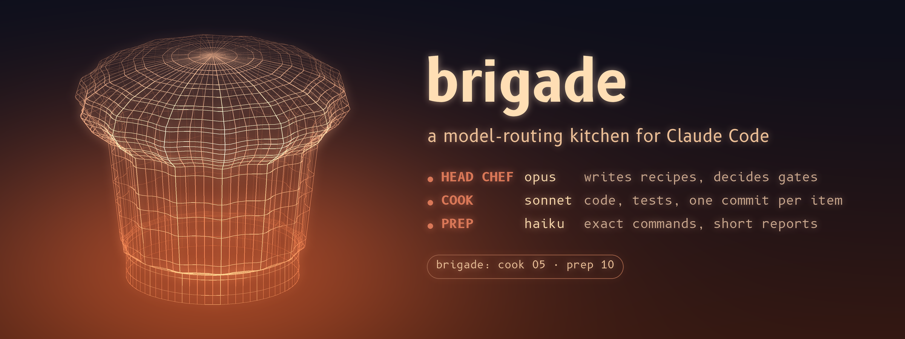

# brigade

A model-routing kitchen for multi-agent work in Claude Code. The main session is the **head chef**: it writes recipes (task
briefs in `work/recipes/`), decides gates (`work/gates.md`) and reviews short reports. It doesn't cut vegetables.

- `brigade:cook` (Sonnet) cooks one recipe: code with tests, one commit per item, a report of 20 lines or fewer.
- `brigade:prep` (Haiku, low effort) runs exact commands (setup, builds, checks, log summaries) and stops at judgment calls.

## Commands

- `/brigade:init [project]`: writes `KITCHEN.md` (the hard rules every cook reads first), `RUNBOOK.md`, `work/gates.md`
  and `work/recipes/00-template.md`, never overwriting, and asks you to confirm the hard rules.
- `/brigade:recipe <task>`: the head chef reads the code, writes the next recipe and picks its cook honestly.
- `/brigade:cook <NN> [notes]` and `/brigade:prep <NN> [notes]`: dispatch recipe NN in the background; the head chef
  reviews the report when it arrives. A second cook in the same repo gets its own worktree.
- `/brigade`: a short help.

While cooks run, the status line shows who is on the stove (`brigade: cook 05 · prep 10`).

Born on the KBOS-V4 X-Plane conversion (2026-10-27): there, Haiku did setup, baselines and builds, Sonnet the ports and
investigations, and one Opus head chef only read reports.

## Install

At the prompt of a Claude Code terminal session:

```
/plugin install brigade --marketplace Yosh145/brigade
```

Answer `y` to add the marketplace, then pick a scope. From a shell: `claude plugin install brigade --marketplace Yosh145/brigade`.
In the desktop app: click + next to the prompt box, then Plugins, Add marketplace with `Yosh145/brigade`, then Add plugin.

MIT licensed.
